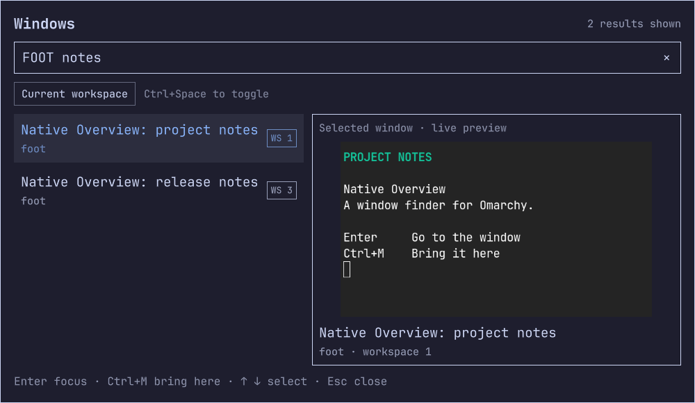
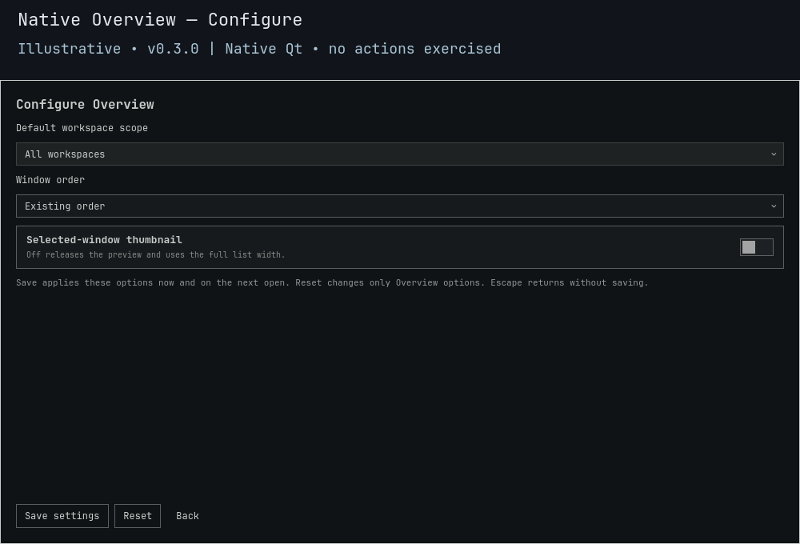

# Native Overview

**Find the window. Keep your place.** Search existing windows by title or application, inspect the selected window, then jump to it or bring it to the workspace you're using.

**0.3.1 development/testing source snapshot, not a stable release.** Uses a public plugin identity and a fresh runtime URL. Independent community plugin for Omarchy's Quattro shell, not a replacement shell or an official Omarchy component.

[Controls](#controls) · [Configure](#configure) · [Install and open](#install-and-open) · [Updates](#updates) · [Safety](#safety-and-limits) · [Tests](#validation-and-development)





*Illustrative **0.3.0** native Qt component renders, with fictional windows and thumbnails disabled. No live desktop, window action, Save or Reset was exercised by these captures. [Preview provenance](docs/PREVIEW.md); [historical 0.2.0 capture](docs/images/README.md).*

## One search, two ways to continue

The window you need is on workspace 1. You're working on workspace 3:

| You want to… | Control | Result |
|---|---|---|
| Go to that window | Enter or click its result | Focus the window and follow it to its workspace. |
| Keep working here | Ctrl+M | Bring that window here without following another workspace. This does not guarantee keyboard focus on the moved window. |

Every search word must match the same window, across its title and app name, in any order. `FOOT notes` matches a Foot window whose title contains “notes”. This is case-insensitive substring matching, not fuzzy search or an application launcher.

Wide views place results beside the preview. Smaller views stack them; very short/large-font views prioritize a readable list and omit the preview/header instead of squeezing text. Results scroll; a small view need not display all matching rows simultaneously. With thumbnails off, the list takes the full width and no capture component starts.

## Controls

| While the window finder has focus | Action |
|---|---|
| Type / Backspace | Search/edit, up to 256 input code units. |
| ↑ / ↓ | Select and scroll to a result. |
| Enter or click a result | Focus it after fresh membership verification. |
| Ctrl+M | Explicitly bring the selected window here. |
| Ctrl+Space / Current workspace | Toggle temporary scope without clearing the query. |
| × | Clear the query, keep scope. |
| Configure / Ctrl+, | Open native saved settings. |
| Escape / click outside | Close and release client data and the preview. |

Closing clears the query, selection and temporary scope. On the next open the **saved default scope** is reapplied. Search/filter/sort never move or close windows by themselves. If an explicit action fails, the finder stays open with retry feedback.

## Configure

| Saved option | Choices | Default |
|---|---|---|
| Default workspace scope | All workspaces / Current workspace | All |
| Window order | Existing order / Application then title / Workspace then application then title | Existing |
| Selected-window thumbnail | On / Off | On |

- **Existing order** preserves the compositor response order. Name comparisons use lowercased application and title strings, not full Unicode case folding or locale-dependent collation. Workspace sorting is numeric; exact ties retain response order. Filtering and sorting happen before the 256-result display cap.
- **Save settings** validates and writes the options, then applies them now and on the next open. Configure itself never dispatches a window action. Preview capture is released while Configure is visible.
- **Reset** explicitly restores only these three Overview options. It does not touch another plugin, window, binding, custom preset or unrelated legacy preference fields.
- **Back / Escape** discards an unsaved draft. Native Tab navigation reaches both dropdowns, the thumbnail toggle and the action buttons; Enter/Space opens/selects controls. At compact sizes the settings area scrolls the focused control into view.

Preferences live outside the installation at:

```text
${XDG_CONFIG_HOME:-$HOME/.config}/omarchy/lego/native-overview/preferences.json
```

Only option values are saved: no window addresses, titles, contents or action history. The private, owned store uses locked read-modify-write and atomic replacement. A read creates nothing and does not change ordinary shared ancestor permissions. New saves are bounded to 128 KiB; fully validated legacy reads to 16 MiB. The settings-only helper accepts fixed read/save/reset verbs, not arbitrary paths, client actions or commands. It requires existing Python 3; no package is installed.

An unsafe, corrupt or inaccessible file is preserved rather than silently overwritten. Read failures show a warning and use defaults for that opening; save failures retain the previously confirmed options. Repair/preserve the file and retry. Reset is not a corruption bypass.

## Install and open

Requires Omarchy Quattro, its native UI components and Hyprland Lua dispatchers. Commands below install the repository’s default branch, **not a stable release tag**. Read the qualification limits before enabling.

```bash
omarchy plugin add https://github.com/Battlelamb/omarchy-native-overview --enable
omarchy-shell shell toggle battlelamb.native-overview '{}'
```

Start typing, select with the arrows, then Enter or Ctrl+M. Keep an existing **Super+D** binding: this plugin neither installs nor changes keybindings. Review source and native installation confirmations; plugins execute with your user permissions inside the shell.

## Updates

For an installation already using `battlelamb.native-overview` and tracking the public repository:

```bash
omarchy plugin update battlelamb.native-overview
```

**Namespace migration:** an installation under an older plugin ID must have its checkout, enabled state and menu/shortcut references migrated together. The normal update command does not rename plugin IDs. Back up the old checkout and preserve the stable preference path above; adding the new ID alone can leave duplicate installations. Existing Super+D bindings need their target updated without changing the key itself.

The new entry point uses `runtime/0.3.1/`. Preferences stay outside that tree. `featureRevision()` returns `0.3.1` to identify the running component; the manifest alone is not sufficient. Closed timers/helpers remain stopped while the root retains lifecycle ownership.

**Full current-version real-shell upgrade/rollback is not qualified by source or component tests.** Retain a rollback copy and inspect installed state after an IPC failure; do not restart the shell merely to hide stale loading. Existing public tags and history remain unchanged.

Disable or remove deliberately:

```bash
omarchy-shell shell hide battlelamb.native-overview
omarchy plugin disable battlelamb.native-overview
# Save local source edits before deleting the checkout:
omarchy plugin remove battlelamb.native-overview --yes
```

Preferences remain outside the checkout. Remove an optional binding separately.

## Compatibility

Historical 0.2.0 integration exercised Omarchy **4.5.0rc2-1**, Hyprland **0.56.2-4**, Omarchy Quickshell **0.3.2** and Qt **6.12.0**. This does not establish compatibility with every later host release.

The 0.3.0 private native component runs use installed Omarchy controls and Quickshell 0.3.2, real Qt font metrics, software rendering and an isolated labwc compositor, with fixture metadata/lock responses and a test output-selection facade. They are **not** full Omarchy-shell, real-window capture, live dispatch or upgrade tests.

Runtime facilities: `hyprctl`, `omarchy-hyprland-session-locked` (uses `jq`), GNU `timeout`, `bash`, `head`, and **Python 3** for options. The plugin imports `qs.Ui`, `qs.Commons`, `Quickshell.Hyprland` and `Quickshell.Wayland`; it installs none of them and needs no shared plugin framework.

## Safety and limits

**Unsandboxed shell plugin, not an authentication or lock-screen boundary.**

- Read-only client metadata drives display. Every focus/bring-here action independently fetches and validates fresh membership; saved options and cached rows never authorize it.
- No automatic window moves or closes, arbitrary command runner, network requests, clipboard access, privileged helper or persistent private-window database.
- Lock state must be explicitly unlocked before admission, is rechecked after preferences load, and is sampled every 250 ms while open. Unknown/error results fail closed. Sampling is not instantaneous or a zero-frame privacy guarantee.
- Only the selected window is eligible for screencopy while open, in Command mode, with thumbnails enabled and enough layout space. Configure, hide and close release that component. No claim of forensic frame erasure.
- A close/address reuse/lock transition after verification remains a timing risk. Cancellation suppresses retired callbacks and uses bounded OS watchdogs; it cannot revoke an already accepted compositor action or an already completed preference write.
- Client JSON is capped at **1 MiB UTF-8**, results at **256**, and bring-here destinations at ordinary workspaces **1–9999**. Sorting never broadens that action boundary.
- Full IME/accessibility, usable second-display/hotplug, GPU capture denial/stalls and long-duration isolated resource behavior remain incomplete.
- **The historical whole-shell resource gate remains failed.** A private component pass does not repair it or establish leak-free/GPU behavior.

[Security reporting](SECURITY.md) · [Detailed validation and historical limits](docs/VALIDATION.md)

## Validation and development

Use existing dependencies; do not test against a real HOME or desktop:

```bash
bash test.sh
bash tests/native-io.test.sh
bash tests/native-overview.test.sh "$TMPDIR/native-overview-evidence"
python3 scripts/check-package.py
```

`test.sh` uses offline bubblewrap, a read-only package and fake HOME. It covers model/schema/cancellation behavior, settings-only persistence, malformed UTF-8/JSON/schema inputs, private paths, atomic-failure preservation, legacy budgets and missing-package-dependency controls. The separate I/O runner exercises actual Qt processes and deadlines.

The native Overview runner starts a **private headless labwc inside offline bubblewrap**, drives actual native Qt controls with private Wayland key input, saves/reloads/resets real files under fake HOME, captures rendered fixture UI, and checks wide/compact/large-font geometry and closed helpers. It never binds host sockets or the user's settings. `labwc`, `wtype`, existing Omarchy/Qt and fonts are needed locally. Settings can require scrolling at large font/small height. No synthetic fixture capture is a public real-window demo.

Local results and source-specific limits are in [VALIDATION](docs/VALIDATION.md). The hosted workflow is component-only; check [Actions](https://github.com/Battlelamb/omarchy-native-overview/actions/workflows/checks.yml) on the exact commit for hosted results. Current previews are illustrative native component renders. Screenshots and component checks alone do not establish a desktop speedup, memory reduction, stable release or complete installation qualification.

### Source map

| Runtime file | Responsibility |
|---|---|
| [Overview.qml](runtime/0.3.1/Overview.qml) | Command/Configure composition, admission, selection and action lifecycle. |
| [Settings.qml](runtime/0.3.1/Settings.qml), [Options.js](runtime/0.3.1/Options.js) | Native typed options editor and strict wire/verb checks. |
| [settings.py](runtime/0.3.1/settings.py), [preferences.py](runtime/0.3.1/preferences.py) | Settings-only CLI and bounded private atomic store. |
| [WindowModel.js](runtime/0.3.1/WindowModel.js) | Fresh validation, filtering, stable sorting and bounded action requests. |
| [WindowPreview.qml](runtime/0.3.1/WindowPreview.qml) | Lifecycle-bound selected-window capture/fallback. |
| [BoundedProcess.qml](runtime/0.3.1/BoundedProcess.qml) | Per-request ownership, output caps and process deadlines. |

## Credits and licence

[GPL-3.0-only](LICENSE). Preview lifecycle adapts a narrow fragment of end-4/dots-hyprland at `2f2a376fdb2ad738bf55f693dd0b474b64bb0ab8`; full paths and attribution remain in [NOTICE](NOTICE.md). The private preference helper is reused from our GPL Glyph Picker 0.3.0; native controls are imported from Omarchy, not vendored into the runtime. No entire ii shell is ported.

[Contributing](CONTRIBUTING.md) · [Changelog](CHANGELOG.md) · [Report a bug without private titles/screenshots](https://github.com/Battlelamb/omarchy-native-overview/issues/new/choose)
