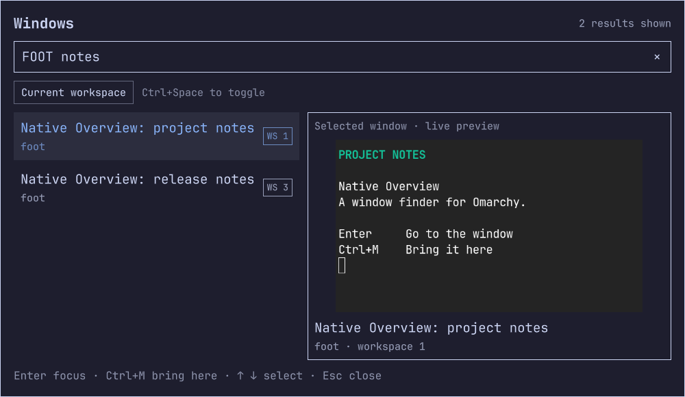
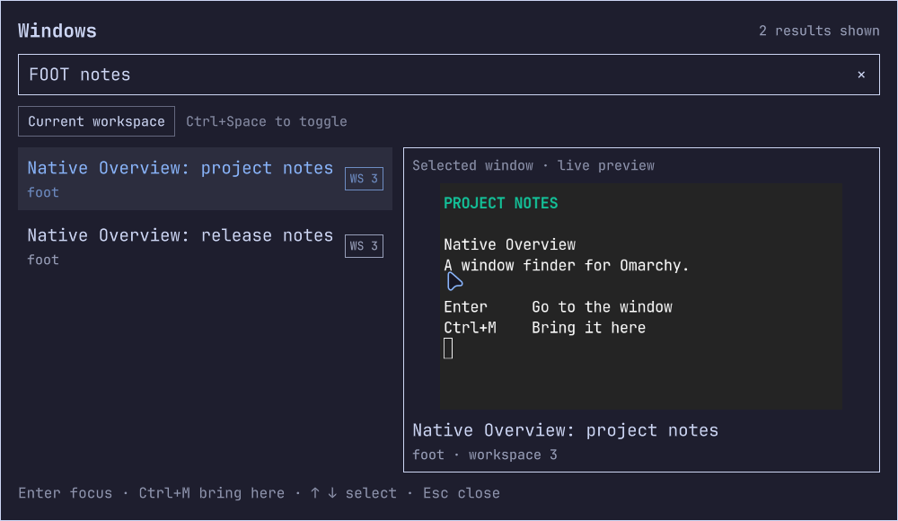
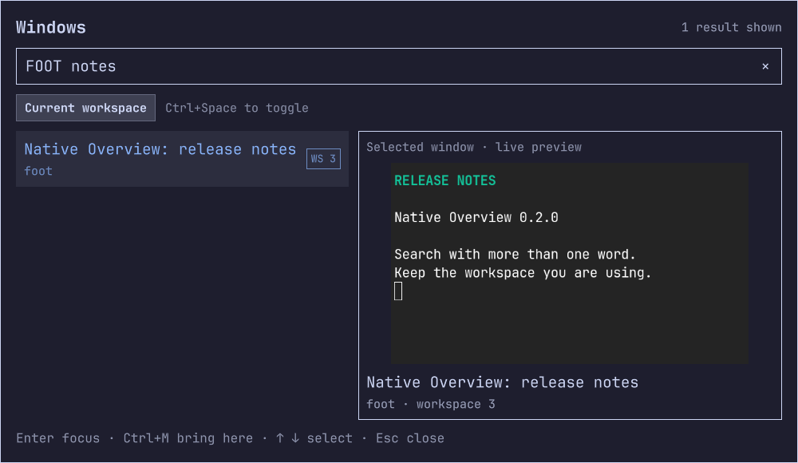

# Native Overview

**Find the window. Keep your place.**

A keyboard-first window finder for the **Omarchy Quattro shell**. Search your open windows, check the selected window's live preview, then jump to it or bring it to the workspace you're already using.

[](https://github.com/Battlelamb/omarchy-native-overview/actions/workflows/checks.yml)

[Quick start](#quick-start) · [Controls](#controls) · [Updates](#updates) · [Compatibility](#compatibility) · [Troubleshooting](#troubleshooting) · [Known limits](#safety-and-known-limits)



*Real 0.2.0 capture in an isolated Hyprland session. The terminals contain sample notes, not private desktop content. [Image provenance](docs/images/README.md).*

**Current release: [0.2.0](https://github.com/Battlelamb/omarchy-native-overview/releases/tag/v0.2.0)** · Early community pre-release · [GPL-3.0-only](LICENSE)

Built for the shell you already use. No replacement shell, compositor plugin, background daemon or package installer is bundled. This is an independent community project, not an official Omarchy component.

[Marketplace listing](https://omarchyplugins.com/plugin.html?id=leviathan.native-overview) · [Listing verification record](https://github.com/omacom/omarchy-plugin-marketplace/issues/13452). Automated marketplace verification is snapshot-specific, not a full security review or an endorsement of every later commit.

## One search, two ways to continue

The window you need is on workspace 1. You're working on workspace 3.

| You want to… | Press | What happens |
|---|---|---|
| Go to that window | <kbd>Enter</kbd> | Focus the selected window, following it to its workspace. |
| Keep working here | <kbd>Ctrl</kbd> + <kbd>M</kbd> | Move the selected window to your current workspace without switching your view elsewhere. |

Search by **window title or application name**, inspect one live preview, and use the same two actions whether the result is nearby or on another workspace. Clicking a result uses the same focus action as Enter.

Ctrl+M moves the window without following it; it does not guarantee keyboard focus on the moved window.

This works with **existing windows**. It does not launch applications, display a workspace thumbnail grid or provide drag-and-drop tiling.

<details>
<summary>See the same window after “bring here”</summary>



The screenshot was taken after a real Ctrl+M action and reopening the overview. The selected window moved; the viewing workspace stayed at 3.

</details>

## Search less, see more

- **Match words in any order.** `FOOT notes` finds an application named `foot` with `notes` in its title. Every word must match the same window.
- **Narrow the list without moving anything.** Click **Current workspace** or press <kbd>Ctrl</kbd> + <kbd>Space</kbd>. The query stays intact.
- **Clear without losing scope.** Click the search field's **×** button. Closing and reopening resets both the query and the workspace filter.
- **Inspect at a useful size.** Wide windows put the list beside a larger preview; smaller windows stack them and wrap the footer.

<details>
<summary>See the current-workspace filter</summary>



The filter changes the list, not the windows' workspaces. The count reports displayed results, not an uncapped total.

</details>

## Quick start

Requires the Omarchy Quattro shell and Hyprland's Lua dispatchers. Check the [exercised versions](#compatibility) if you're on a different release. This is not a standalone Quickshell configuration.

### 1. Install

```bash
omarchy plugin add https://github.com/Battlelamb/omarchy-native-overview --enable
```

Use Omarchy's normal confirmation and review the source before enabling. Like other shell plugins, this code runs with your user permissions inside the existing shell.

### 2. Open

```bash
omarchy-shell shell toggle leviathan.native-overview '{}'
```

Start typing a title or application name. Select a result with the arrow keys, then use Enter or Ctrl+M. Escape closes the overview.

### 3. Add a shortcut, if you want one

The installer **does not bind keys automatically**. Existing users can keep their current Native Overview binding.

<details>
<summary>Optional Super+D binding for Omarchy's Lua configuration</summary>

Only use Super+D if it is free. Do not add a second copy if you've already configured it.

Back up your existing file first:

```bash
cp -p "$HOME/.config/hypr/bindings.lua" \
  "$HOME/.config/hypr/bindings.lua.bak-native-overview-$(date +%Y%m%d-%H%M%S)"
```

Add this line to `~/.config/hypr/bindings.lua`:

```lua
o.bind("SUPER + D", "Native Overview", "omarchy-shell shell toggle leviathan.native-overview '{}'")
```

Apply and check for configuration errors:

```bash
hyprctl reload
hyprctl configerrors
```

Choose a different unused combination if Super+D already belongs to another action. The plugin itself never edits your keybindings.

</details>

## Controls

These controls apply while the overview has keyboard focus.

| Key or action | Result |
|---|---|
| Type | Match every search word across titles and application names, case-insensitively. |
| <kbd>↑</kbd> / <kbd>↓</kbd> | Select a result. |
| <kbd>Enter</kbd> or click a result | Focus the selected window. |
| <kbd>Ctrl</kbd> + <kbd>M</kbd> | Bring the selected window to the current workspace. |
| <kbd>Ctrl</kbd> + <kbd>Space</kbd> or Current workspace | Toggle the current-workspace filter without clearing the query. |
| Click **×** | Clear the query and keep the current scope. |
| <kbd>Backspace</kbd> | Edit the search. |
| <kbd>Esc</kbd> or click outside the card | Close the overview. |

Each word uses substring matching, not fuzzy matching. Search edits reuse validated display data; focus/move still re-read fresh clients. Closing clears the query, scope and window state and releases the preview component. If an action fails, the overview keeps your search and shows retry feedback rather than claiming success.

## Updates

For installations from the public GitHub repository:

```bash
omarchy plugin update leviathan.native-overview
```

Back up local modifications before updating. The runtime uses a versioned path so a rescan cannot silently reuse the older flat-path QML component. **0.2.0 adds the new layout, multi-word search, workspace filter and clear control.** It retains the 0.1.2 malformed-input, retired-response, lock-startup and subprocess-lifetime hardening. Existing shortcuts stay unchanged.

Installation and updates follow the repository's current default branch. A marketplace entry does not pin mutable HEAD to an immutable reviewed release.

<details>
<summary>Using an older private or local frozen checkout?</summary>

A checkout whose origin is a local frozen repository does not follow GitHub releases. Preserve that checkout and your configuration, then deliberately replace it with an installation from the public repository. Do not move old tags or discard local work to make an update appear successful.

</details>

<details>
<summary>Disable or remove the plugin</summary>

Hide and disable without deleting your checkout:

```bash
omarchy-shell shell hide leviathan.native-overview
omarchy plugin disable leviathan.native-overview
```

When you intentionally want to delete the installed checkout, save local changes first, then run:

```bash
omarchy plugin remove leviathan.native-overview --yes
```

Remove your optional shortcut separately. There is no custom daemon, system package or service to uninstall.

</details>

## Compatibility

These versions were exercised for 0.2.0. Other combinations are **not established as compatible**.

| Component | Exercised version |
|---|---|
| Omarchy | 4.5.0rc2-1, Quattro shell |
| Hyprland | 0.56.2-4, Lua dispatchers |
| Quickshell | Omarchy build 0.3.2 |
| Qt | 6.12.0 |

The plugin imports the installed `qs.Ui`, `qs.Commons`, `Quickshell.Hyprland` and `Quickshell.Wayland` APIs. Runtime commands are `hyprctl`, GNU `timeout`, `bash`, `head` and `omarchy-hyprland-session-locked`; the installed lock helper uses `jq`. These are existing runtime facilities, not packages the plugin installs for you.

## Safety and known limits

**The plugin runs unsandboxed inside your shell. It is not a lock screen or an authentication boundary.**

| Access | Scope |
|---|---|
| Window metadata | Titles, applications, addresses, workspaces and outputs, used for search and validated actions. |
| Selected-window screencopy | Only the selected preview while the overview is open. |
| Focus and move dispatches | Explicit user actions, after a fresh client lookup. |
| Compositor lock helper | Checked before opening and sampled every 250 ms while open. Unknown state fails closed. |

The plugin supplies **no network requests, telemetry, clipboard reader, persistent private-window database or privileged helper**. The shell and other enabled plugins may have broader capabilities. See [SECURITY.md](SECURITY.md) for the trust boundary and private vulnerability-reporting route.

Important limits:

- Lock sampling is not instantaneous and is not a zero-frame privacy guarantee. A close, address reuse or lock transition after verification remains a timing risk.
- Bring-here destinations are normal workspaces **1–9999**, not special workspaces.
- Input is bounded to **1 MiB of UTF-8 client JSON** and at most **256 matching results** are displayed. This is not an unbounded window index.
- Text entry uses key-event filtering, not a complete text field. IME, accessibility and exhaustive mouse/theme coverage remain incomplete.
- Usable second-display rendering, physical unplug, GPU/compositor capture denial and retained-frame stalls have not been fully verified.
- **The whole-shell resource gate remains failed.** Observed extra descriptors mapped to Tailscale/GPU polling and returned to baseline. That attribution is not a green gate, an isolated plugin-cost measurement or a leak-free guarantee.

[Full validation record and remaining coverage →](docs/VALIDATION.md)

## Troubleshooting

<details>
<summary>Installed, but nothing opens</summary>

Check the [version requirements](#compatibility), make sure the overlay is enabled, then try the explicit command:

```bash
omarchy plugin enable leviathan.native-overview
omarchy-shell shell toggle leviathan.native-overview '{}'
```

The overview deliberately stays closed if the compositor lock helper reports locked, unknown or unsuccessful. Do not bypass that check. This plugin must be loaded by Omarchy's shell, not run as a second standalone Quickshell instance.

</details>

<details>
<summary>The preview says “Preview unavailable”</summary>

The selected window may have closed, or the compositor has not supplied usable preview content. Select another result or reopen the overview. The fallback is intentional; it is not evidence that every GPU/capture-denial case is supported.

</details>

<details>
<summary>A window closed, moved, or an action failed</summary>

The current client list is re-read before dispatch. A disappeared selection is refreshed away. A failed command or acknowledgement leaves the overview open with retry feedback and preserves your search. Press Enter to retry an available selection or Escape to close.

</details>

<details>
<summary>An update reports “omarchy-shell is not responding”</summary>

A rescan can outlast the CLI's default two-second IPC window in a long-running session. A failed reply does not prove that the filesystem update was rolled back: inspect the installed checkout and plugin state before repeating a potentially completed operation.

For a planned update, the existing CLI setting can give that invocation a bounded ten-second IPC window:

```bash
OMARCHY_SHELL_IPC_TIMEOUT=10s omarchy plugin update leviathan.native-overview
```

Keep errors visible. Do not restart the long-lived, lock-hosting shell just to hide an IPC error. Preserve local work and backups before recovery.

</details>

## Validation and development

[Component CI](https://github.com/Battlelamb/omarchy-native-overview/actions/workflows/checks.yml) checks JavaScript behavior and package layout. It does **not** render Omarchy or certify GPU behavior.

<details>
<summary>0.2.0 execution summary and local development commands</summary>

| Check | Recorded result |
|---|---|
| Component suites | 13 model + 28 lifecycle + 3 UI-contract groups passed. |
| Native offscreen Qt/Quickshell | 18 checks passed. |
| Nested core exercise | 12 passed; 2 unusable headless-mode setup failures retained separately, not counted as responsive coverage. |
| Responsive layouts | 5 checks passed at actual 800×600 and 480×360 sizes, booting an isolated shell at each size. |
| Preview soak | 40 paced cycles; 44 preview creations/44 destructions across the core exercise. |
| Upgrade and rollback | 12 checks passed: actual 0.1.2→0.2.0 reload, failed-clone rollback and preserved settings. |

These are scoped observations, not a blanket security/performance certification. The native checks were run locally, separately from hosted component CI. [Detailed evidence and limits](docs/VALIDATION.md).

Development requires the existing Node, Python 3, bubblewrap and installed Omarchy/Quickshell environment:

```bash
omarchy plugin validate .
bash test.sh
bash tests/native-io.test.sh
python3 scripts/check-package.py
```

The native runner uses an offline bubblewrap sandbox and Qt's offscreen/software path. It is not a substitute for compositor integration tests.

</details>

### Source map

| File | Responsibility |
|---|---|
| [`Overview.qml`](runtime/0.2.0/Overview.qml) | Search UI, selection, refresh scheduling and action lifecycle. |
| [`WindowPreview.qml`](runtime/0.2.0/WindowPreview.qml) | Selected-window capture and unavailable-content fallback. |
| [`BoundedProcess.qml`](runtime/0.2.0/BoundedProcess.qml) | Per-request ownership, raw-output caps and process supervision. |
| [`WindowModel.js`](runtime/0.2.0/WindowModel.js) | Strict input validation, filtering and bounded focus/move requests. |
| [`tests/`](tests/) | Component regressions and native subprocess checks. |

Small, focused fixes and compatibility reports are welcome. Include versions and a minimal reproduction, not private window titles, unrelated logs or desktop data. Read [CONTRIBUTING.md](CONTRIBUTING.md) before proposing larger changes.

## Credits and licence

The preview lifecycle adapts a narrow `ScreencopyView` fragment from [end-4/dots-hyprland](https://github.com/end-4/dots-hyprland) at commit `2f2a376fdb2ad738bf55f693dd0b474b64bb0ab8`. Full source paths and attribution are retained in [NOTICE.md](NOTICE.md). This is not a port of the entire ii shell.

Omarchy's components are imported, not vendored or modified. Native Overview is distributed under **[GPL-3.0-only](LICENSE)**.

[Release notes](CHANGELOG.md) · [Report a public bug](https://github.com/Battlelamb/omarchy-native-overview/issues/new/choose) · [Report a security issue privately](https://github.com/Battlelamb/omarchy-native-overview/security/advisories/new)
